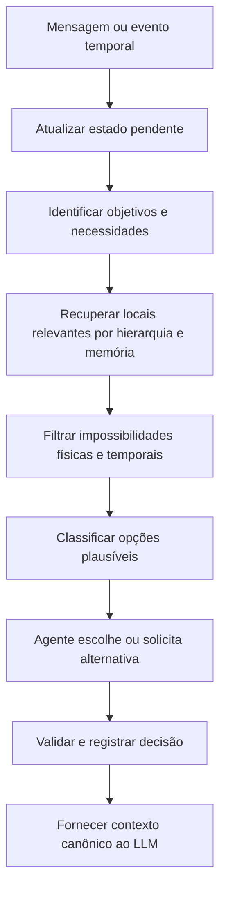

# GeoSpace — Weak

**Documento de concepção e planejamento | v0.1 | 15/11/2026**  
**Status:** proposta para discussão; nenhuma implementação iniciada.  
**Próxima etapa:** [GeoSpace Mid](02_GeoSpace_Mid.md) · **Visão ampliada:** [GeoSpace Strong](03_GeoSpace_Strong.md)

> **Tese:** um agente de linguagem pode produzir comportamentos espacialmente mais coerentes quando suas decisões são condicionadas por um ambiente persistente que não é inventado a cada mensagem.

## 1. Propósito

O **GeoSpace Weak** é a versão mínima, experimental, de um sistema de **agência situada** para personagens/companions. Seu papel não é criar consciência artificial, simular fisicamente uma cidade ou construir um videogame. Seu papel é oferecer *resistência espacial e temporal* às decisões de um agente: lugares existem, têm relações, deslocamentos exigem tempo e experiências anteriores modificam hábitos e escolhas futuras.

A referência conceitual vem da Geografia de Redes, da produção social do espaço (Henri Lefebvre) e da experiência subjetiva dos lugares (topofilia/topofobia, associada à Geografia Humanista). Esses conceitos **inspiram o projeto**; as métricas computacionais não pretendem equivaler integralmente às categorias filosóficas nem provar experiência subjetiva da IA.

### Hipóteses a testar

1. Um **estado espacial persistente** reduz contradições de localização em relação a um agente que apenas improvisa respostas.
2. **Tempos de percurso e horários** melhoram a plausibilidade de ações e narrativas sem reduzir o personagem a um cronograma inflexível.
3. **Memórias espaciais diferenciadas** (frequência, familiaridade, afinidade, aversão, episódios) produzem hábitos reconhecíveis, sem impedir novidade.
4. Um **mapa opcional** melhora a compreensão do mundo pelo usuário, mas não deve transformar automaticamente a experiência em um jogo de gerenciamento de atributos.

## 2. Não objetivos desta fase

- Cartografia georreferenciada, GPS, raster, Shapefile, OpenStreetMap ou navegação rua a rua.
- Simulação contínua minuto a minuto, modelos climáticos ou trânsito.
- Múltiplos agentes autônomos com economia ou instituições sociais próprias.
- Dependência obrigatória da futura API/ambiente de applets do Kindroid.
- Declarações de que o agente tem sentimentos reais ou consciência.
- Mostrar todos os estados internos ao usuário ou revelar informações privadas do personagem sem regra explícita.

## 3. Ontologia mínima do mundo

### 3.1. Estrutura hierárquica

Um **grafo de lugares**, com nós e arestas, organizado por níveis de escala. A hierarquia descreve pertencimento; as arestas descrevem conectividade e custo. São relações distintas.

```text
Mundo
└── Cidade
    ├── Bairro A
    │   ├── Casa
    │   │   ├── Cozinha
    │   │   └── Quarto
    │   ├── Padaria
    │   └── Café
    └── Bairro B
        ├── Universidade
        └── Farmácia distante
```

**Nó (`Place`)**: ID estável; nome; tipo; ID do nó-pai; descrição; imagem opcional; tags; regras básicas de acesso; horários opcionais; proveniência dos dados. **Aresta (`Connection`)**: origem; destino; direção; modalidade; duração mínima/estimada; acessibilidade; condição de uso; proveniência.

A localização canônica de cada personagem é **um nó** ou **uma transição em andamento entre nós**. Não pode ocupar simultaneamente dois locais incompatíveis. A localização *declarada em uma mensagem* não substitui automaticamente a localização canônica.

### 3.2. Estado do personagem

- `current_place_id` ou `journey_id` em andamento.
- `updated_at` e fuso horário do mundo.
- Rotina, obrigações, metas, compromissos e necessidades relevantes.
- Lugares conhecidos e experiências por personagem.
- Histórico de decisões/eventos com identificação e origem.
- Grau de visibilidade de fatos para o usuário: público, conhecido pelo personagem, reservado/oculto.

### 3.3. Modelo temporal

- **Tempo de parede** (relógio real) e **tempo simulado** não devem ser confundidos. O projeto deve escolher uma política explícita: acompanhar o tempo real, pausar ou acelerar em cenários ficcionais.
- Transições possuem `depart_at`, `earliest_arrival_at` e, quando aplicável, `arrived_at`.
- Um evento registrado tem carimbo temporal e não é reexecutado ao reler uma conversa.
- Se o usuário passa horas sem interagir, o mundo é **atualizado sob demanda**: resolver eventos pendentes e transições até o instante solicitado, sem fazer milhares de chamadas ao LLM.
- O motor deve distinguir **fatos confirmados**, **estimativas**, **propostas** e **desconhecidos**.

## 4. Experiência espacial e pesos por personagem

Um mesmo lugar pode ser frequente, familiar e desagradável ao mesmo tempo. Não condensar tudo em um único escore.

| Variável | Semântica | Como evolui |
|---|---|---|
| `visits` | Frequência de visitas confirmadas | Aumenta após uma visita real dentro da simulação |
| `familiarity` | Conhecimento do lugar | Visitas, exploração, experiências |
| `positive_affinity` | Associação positiva | Episódios e avaliações contextualizadas |
| `aversion` | Associação negativa | Episódios adversos |
| `salience` | Facilidade de recuperação na memória | Menções e acontecimentos, com pesos distintos |
| `episodes` | Marcos autobiográficos | Eventos referenciáveis, não apenas valores numéricos |

**Regra fundamental:** *mencionar* a padaria não significa *visitá-la*. Uma pergunta repetida do usuário não pode falsificar o histórico de deslocamento. Uma experiência marcante, mesmo única, pode ter relevância elevada. Afinidade e aversão podem coexistir (ambivalência).

Pesos podem apresentar **saturação** (ganhos decrescentes), **decaimento temporal** e atualização conforme a intensidade do evento. Não usar reforço ingênuo infinito nem obrigar que o agente visite sempre o nó de maior pontuação.

## 5. Decisão condicionada, não roteirização absoluta

### 5.1. Fluxo de decisão



**Restrições rígidas:** não teletransportar; não entrar em locais impossíveis; respeitar arestas e tempos mínimos; não duplicar estados de presença. **Preferências flexíveis:** hábitos, fome, afinidade, chuva *se houver fonte válida*, probabilidade de preferir casa às 2h etc. Um padeiro pode estar na padaria às 4h; uma estudante pode estar lá excepcionalmente, desde que exista explicação compatível e o local esteja acessível.

### 5.2. Heurística inicial (sem modelo treinado)

```text
pontuacao(destino) =
    utilidade_para_objetivo
  + familiaridade * peso_familiaridade
  + afinidade * peso_afinidade
  - aversao * peso_aversao
  - custo_de_deslocamento * peso_custo
  + bonus_de_novidade_contextual
  + pequenas_variacoes_controladas
```

Isso é **uma proposta de variáveis, não fórmula calibrada**. A elegibilidade deve ser verificada *antes* da pontuação. A decisão pode usar ranking, amostragem ponderada ou escolha do LLM dentro da lista válida. Registrar razões e variáveis para posterior auditoria.

## 6. Arquitetura mínima

- **Motor espacial:** Python, grafo em memória (biblioteca de grafos opcional no protótipo), validação de movimentos, filtros e regras.
- **Persistência:** SQLite preferencialmente (ou JSON em um protótipo descartável), com IDs estáveis e eventos idempotentes.
- **Adaptador de agente:** envia um contexto pequeno com localização, destinos elegíveis, compromissos e restrições; recebe uma intenção estruturada; **não** concede ao LLM gravação direta e irrestrita do estado.
- **Relógio/agenda:** determina o intervalo decorrido, horários e eventos pendentes.
- **Visualização opcional:** grafo topológico 2D, nós agrupados por escala e detalhes sob demanda.
- **Interface de integração:** porta/adaptador substituível para Kindroid, LLM local ou ambiente de testes; **não presumir** recursos de API ainda não anunciados/documentados.

### Exemplo de registro conceitual

```json
{
  "character_id": "ana",
  "state_at": "2026-11-15T02:00:00-03:00",
  "current_place_id": "home",
  "journey": null,
  "goal": "get_food",
  "candidate_place_id": "bakery",
  "travel_minutes": 11,
  "place_open": false,
  "place_open_source": "fictional_world_rule",
  "decision": "stay_home_and_prepare_food"
}
```

Os números e lugares são fictícios e servem apenas para exemplificar a estrutura.

## 7. Mapa para o usuário: observação, não videogame compulsório

A interface deve apresentar **lugares e ligações**, não necessariamente cada pontuação. Recomendações de primeira versão:

- Dois modos opcionais: **rede funcional** (conexões, tempos) e **rede experiencial** (lugares conhecidos, habituais e marcantes).
- Expandir/recolher bairro → edifício → cômodo, quando existente.
- Destaque discreto para localização conhecida e deslocamento em curso; evitar notificações incessantes.
- Histórico de eventos exposto de acordo com as regras de visibilidade narrativa e privacidade.
- Um local desconhecido deve aparecer como desconhecido, não como uma certeza fabricada.
- A interface pode ser somente leitura na primeira versão; não deixar um clique alterar fatos canônicos acidentalmente.

## 8. Casos de teste fundamentais

| ID | Situação | Resultado esperado |
|---|---|---|
| W01 | Às 02h, personagem está em casa; padaria a 11 min, fechada | Não afirmar compra de pão sem alternativa/justificativa |
| W02 | Sai da universidade às 14h para casa, viagem de 40 min | Às 14h20 ainda está em trânsito, salvo evento de alteração validado |
| W03 | Usuário pergunta 20 vezes sobre farmácia distante | A contagem de visitas da farmácia não aumenta |
| W04 | Local de trabalho é frequente, porém desagradável | Obrigação e afinidade são variáveis independentes |
| W05 | Novo café surge no percurso habitual | Existe chance plausível de descoberta, sem apagar preferências |
| W06 | LLM afirma localização incompatível | Motor rejeita ou reconcilia como declaração não confirmada |
| W07 | Conversa fica inativa durante 9 horas | Atualização por tempo decorrido, sem simular cada minuto |
| W08 | Dois personagens compartilham cidade | Mesma topologia; memórias e preferências distintas |
| W09 | Local com acesso/horário desconhecido | Não fingir certeza: marcar desconhecido ou usar regra explícita do universo |
| W10 | Reprocessamento do mesmo evento | Nenhuma visita ou recompensa duplicada |

## 9. Como medir se o Weak realmente funciona

Comparar dois agentes com perfil, prompts, roteiro de perguntas e cenários semelhantes: **baseline narrativo sem GeoSpace** vs. **GeoSpace Weak**.

- **Contradições espaço-temporais por 100 interações**, auditadas com rubricagem reproduzível.
- **Taxa de deslocamentos válidos** (tempo, continuidade, conectividade).
- **Estabilidade de hábitos** após experiências repetidas, sem bloquear descobertas.
- **Incidentes de estado inventado** (alegação do LLM sem evento válido).
- **Latência e custo por decisão**, separando motor e inferência.
- **Avaliação cega de plausibilidade narrativa**, por leitores que não sabem qual agente usou o sistema.

**Critério de passagem para Mid (a definir após pilotos):** redução consistente de contradições, nenhum teletransporte não justificado nos testes de regressão, persistência confiável, custos aceitáveis e evidência de que a visualização acrescenta compreensão. Não inventar metas numéricas antes de medir o baseline.

## 10. Riscos e limites

- O modelo pode narrar uma ação que o motor não confirmou: exigir separação entre **intenção → validação → evento**.
- Excesso de restrições pode transformar a companion em autômato rígido: preservar escolhas contextualmente incomuns.
- Excesso de pesos explícitos pode virar gamificação indesejada: manter números internos e interface opcional.
- Memória enviesada por repetição de mensagens: separar menção, visita, avaliação e episódio.
- Estado oculto pode revelar detalhes privados por meio do mapa: controlar visibilidade.
- Informações geográficas, temporais e rotinas reais do usuário são sensíveis: preferir dados fictícios e solicitar consentimento para qualquer ligação com localização real.

## 11. Entregáveis da fase

1. Esquema documentado para lugares, conexões, agentes, viagens e eventos.
2. Um universo de testes com aproximadamente 10–20 lugares e 2 personagens.
3. Motor de transições e regras com persistência mínima.
4. Adaptador simples para agente/LLM sem dependência direta do Kindroid.
5. Visualizador opcional topológico, apenas leitura inicialmente.
6. Suíte de cenários W01–W10 e relatório comparativo com baseline.

**Princípio de encerramento:** só expandir para ruas reais quando o grafo abstrato já demonstrar ganho mensurável de coerência.

## 12. Decisões ainda abertas

- O tempo padrão acompanha relógio real ou tempo fictício configurável?
- A decisão final de destino é tomada pelo LLM entre opções validadas, ou por heurística com LLM narrando o resultado?
- Quais episódios podem mudar afinidade/aversão e com que intensidade?
- Como representar lugares que o personagem conhece mas o usuário ainda não conhece?
- Qual o mínimo de dados e logs necessário para reprodução e depuração sem coletar informações excessivas?

---

**Relação com as outras fases:** o **Mid** adiciona geometria e ambiente urbano; o **Strong** acrescenta simulação social/eventos multiagentes. Nenhuma fase deve invalidar o modelo de estado e eventos estabelecido aqui.
